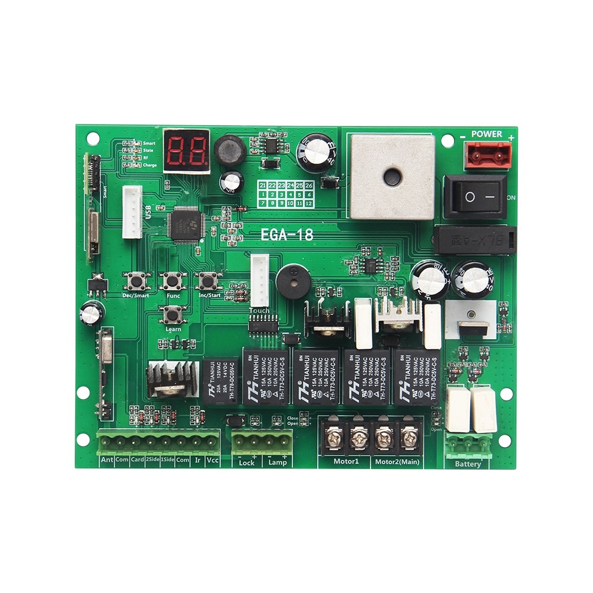
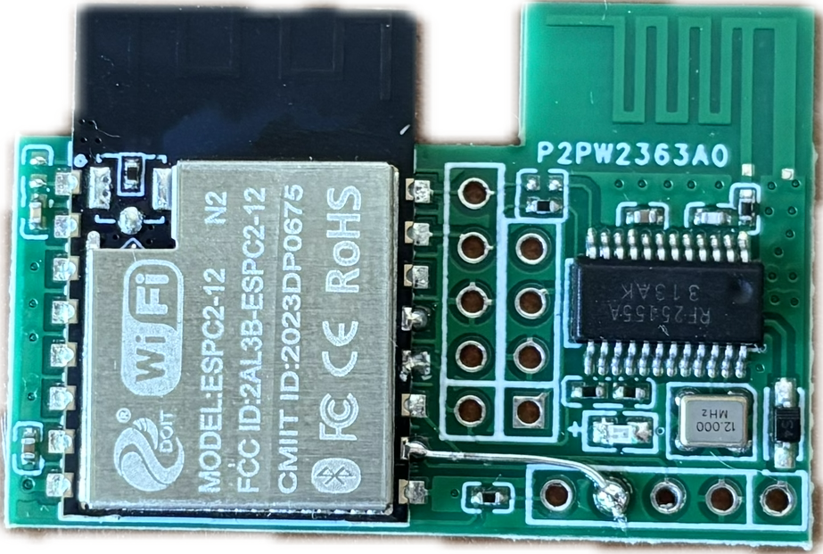

# Hardware — EGA-18 board and Smart module (ESP32-C2)

*Español: [hardware.md](hardware.md)*

Where the module you reflash lives and how to connect. Verified on a real board;
**confirm every signal on yours** in case of different revisions.

> ⚠️ The board runs on **24 V DC** (`POWER` input from a 24 V supply). There is no
> mains voltage, but **disconnect power and the battery** before handling it: the
> motor can move.



## Architecture

```
   24 V DC / motors / limit switches / 24 V battery / RF / display
                              │
                          ┌───┴────┐
                          │ STM32  │   ← the gate's brain (NOT touched)
                          │ F103Rx │
                          └───┬────┘
                    USART1 (PA9/PA10) 115200 8N1
                              │
                     "Smart" connector
                              │
                       ┌──────┴───────┐
                       │ Smart module │   ← what we reflash (ESP32-C2)
                       └──────────────┘
```

- **STM32F103Rx** (LQFP64, the square chip in the center): drives motors, TIANHUI
  relays, limit switches, remote RF, display and battery. Not touched.
- **Smart module:** daughterboard on the `Smart` connector. It carries an
  **ESP32-C2** (ESPC2-12 / ESP8684, 2 MB flash, 26 MHz crystal) and an unknown chip
  marked `RF25155A` that ends up unused. The ESP32-C2 is the one we reflash with ESPHome.



## "Smart" connector (module ↔ STM32)

In the module photo, the `Smart` connector is the **horizontal row at the
bottom-right**; **pin 1 is marked with the square pad** (on the right).

| Pin | Signal      | ESP32-C2 | STM32             |
|-----|-------------|----------|-------------------|
| 1   | VCC 3.3 V   | —        | (from an AMS1117) |
| 2   | GND         | —        | —                 |
| 3   | data        | GPIO7    | PA9 (USART1_TX)   |
| 4   | data        | GPIO6    | PA10 (USART1_RX)  |
| 5   | "Smart" LED | GPIO10   | —                 |

## ESP32-C2 pins for flashing

In the module photo, these pins are the **vertical row next to the ESP**; **pin 1
is marked with the square pad** (at the bottom).

| Pin | What it is                          |
|-----|-------------------------------------|
| 1   | Boot — to GND for download mode     |
| 2   | VCC 3.3 V (power)                   |
| 3   | GND                                 |
| 4   | Flasher TX (USB-UART)              |
| 5   | Flasher RX (USB-UART)              |

## Back up the factory firmware (first!)

No public download: the backup is your only way back. With a **3.3 V USB-UART
adapter** (never 5 V): its TX→pin 4, its RX→pin 5, 3V3→pin 2, GND→pin 3, and
pin 1 (boot)→GND while powering up, to enter the bootloader.

```bash
esptool.py --port /dev/ttyUSB0 read_flash 0 0x200000 esp_stock_backup.bin
```

Restore later:

```bash
esptool.py --port /dev/ttyUSB0 write_flash 0 esp_stock_backup.bin
```

## Flash ESPHome

Same wiring. First time over serial; afterwards, OTA over WiFi.

```bash
esphome run esp-ega1800.yaml
```

The rest (secrets, Home Assistant) is in the [README](../README.en.md).

## Two paths

- **Option A:** your own ESP32 wired to the `Smart` connector
  (ESP TX → pin 4, ESP RX → pin 3, 3V3 → pin 1, GND → pin 2).
- **Option B (recommended):** reflash the ESP32-C2 in place. No new hardware.

Other models (EGA18, EGB18, EGA15, EGB1900…) share the idea but the package or state
layout may differ; see [protocol-uart.en.md](protocol-uart.en.md).
