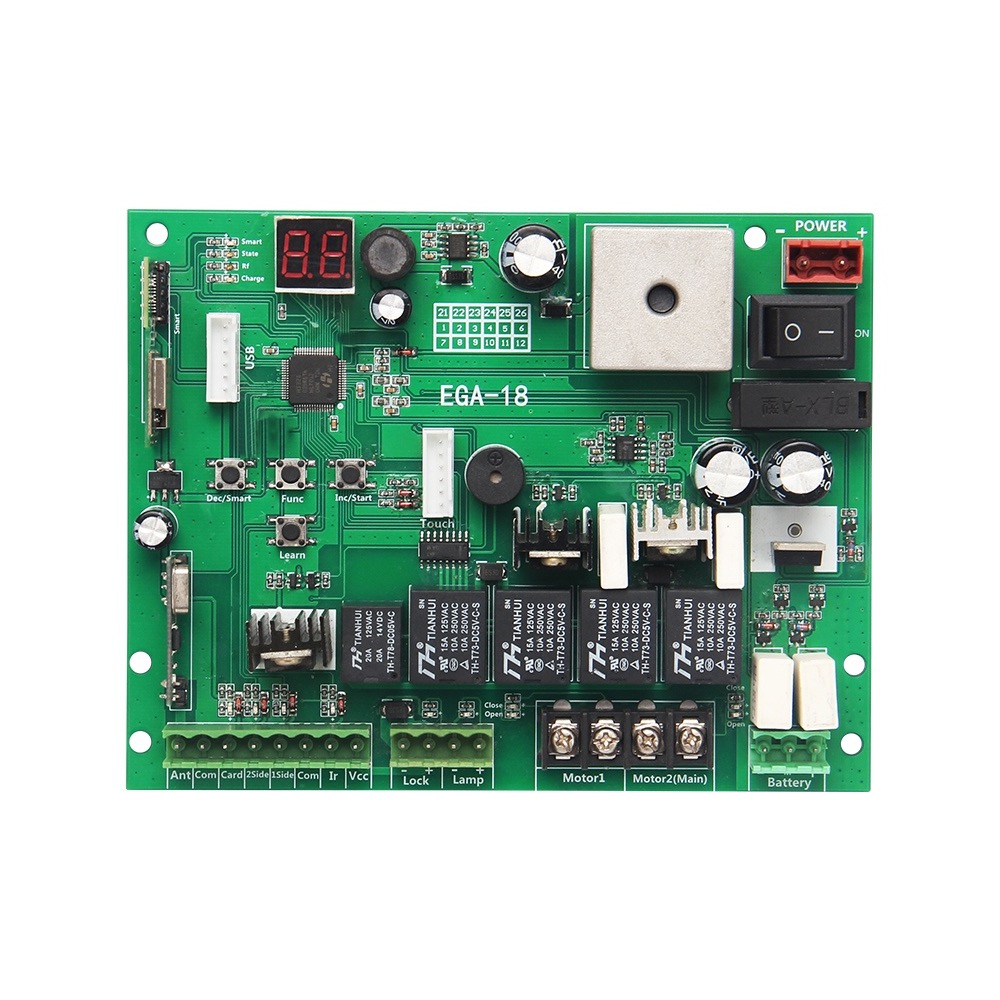
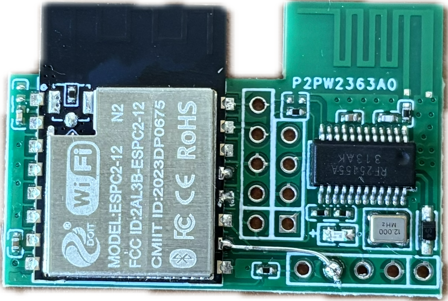

# Hardware — placa EGA-18 y módulo Smart (ESP32-C2)

*English: [hardware.en.md](hardware.en.md)*

Dónde está el módulo que se reflashea y cómo conectarse. Verificado sobre una placa
real; **confirmá cada señal en la tuya** por si hay revisiones distintas.

> ⚠️ La placa trabaja a **24 V DC** (entrada `POWER` desde una fuente de 24 V). No
> hay 220 V, pero **desconectá la alimentación y la batería** antes de manipularla:
> el motor puede moverse.



## Arquitectura

```
   24 V DC / motores / finales de carrera / batería 24 V / RF / display
                              │
                          ┌───┴────┐
                          │ STM32  │   ← cerebro del portón (NO se toca)
                          │ F103Rx │
                          └───┬────┘
                    USART1 (PA9/PA10) 115200 8N1
                              │
                     conector "Smart"
                              │
                       ┌──────┴───────┐
                       │ módulo Smart │   ← lo que reflasheamos (ESP32-C2)
                       └──────────────┘
```

- **STM32F103Rx** (LQFP64, el chip cuadrado del centro): maneja motores, relés
  TIANHUI, finales de carrera, RF de los controles, display y batería. No se toca.
- **Módulo Smart:** daughterboard en el conector `Smart`. Lleva un **ESP32-C2**
  (ESPC2-12 / ESP8684, 2 MB flash, cristal 26 MHz) y un chip desconocido marcado
  `RF25155A` que queda sin usar. El ESP32-C2 es el que reflasheamos con ESPHome.



## Conector "Smart" (módulo ↔ STM32)

En la foto del módulo, el conector `Smart` es la **tira horizontal de abajo a la
derecha**; el **pin 1 está marcado con el pad cuadrado** (a la derecha).

| Pin | Señal       | ESP32-C2 | STM32            |
|-----|-------------|----------|------------------|
| 1   | VCC 3.3 V   | —        | (de un AMS1117)  |
| 2   | GND         | —        | —                |
| 3   | datos       | GPIO7    | PA9 (USART1_TX)  |
| 4   | datos       | GPIO6    | PA10 (USART1_RX) |
| 5   | LED "Smart" | GPIO10   | —                |

## Pines del ESP32-C2 para flashear

En la foto del módulo, estos pines son la **tira vertical al lado del ESP**; el
**pin 1 está marcado con el pad cuadrado** (abajo).

| Pin | Qué es                              |
|-----|-------------------------------------|
| 1   | Boot — a GND para el modo descarga  |
| 2   | VCC 3.3 V (alimentación)            |
| 3   | GND                                 |
| 4   | TX del flasher (USB-UART)           |
| 5   | RX del flasher (USB-UART)           |

## Backup del firmware de fábrica (¡primero!)

No hay descarga pública: el backup es la única vuelta atrás. Con un adaptador
**USB-UART de 3.3 V** (nunca 5 V): su TX→pin 4, su RX→pin 5, 3V3→pin 2, GND→pin 3,
y pin 1 (boot)→GND al alimentar, para entrar al bootloader.

```bash
esptool.py --port /dev/ttyUSB0 read_flash 0 0x200000 esp_stock_backup.bin
```

Restaurar más adelante:

```bash
esptool.py --port /dev/ttyUSB0 write_flash 0 esp_stock_backup.bin
```

## Flashear ESPHome

Misma conexión. La primera vez por serie; después, OTA por WiFi.

```bash
esphome run esp-ega1800.yaml
```

El resto (secrets, Home Assistant) está en el [README](../README.md).

## Dos caminos

- **Opción A:** tu propio ESP32 cableado al conector `Smart`
  (ESP TX → pin 4, ESP RX → pin 3, 3V3 → pin 1, GND → pin 2).
- **Opción B (recomendada):** reflashear el ESP32-C2 en el lugar. Sin hardware nuevo.

Otros modelos (EGA18, EGB18, EGA15, EGB1900…) comparten la idea pero pueden cambiar
el encapsulado o el layout de estado; ver [protocolo-uart.md](protocolo-uart.md).
